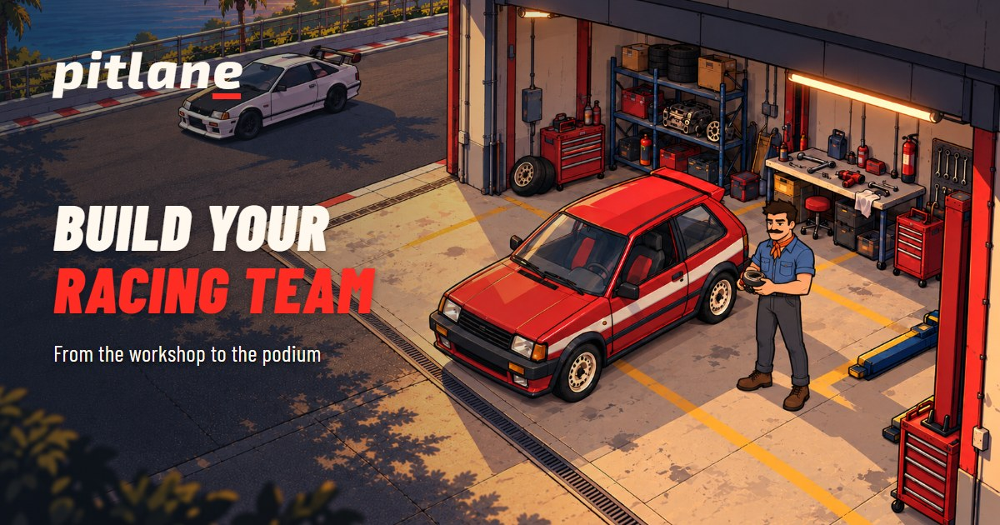

# Pitlane

Pitlane is a browser-based 3D garage tycoon. Start with a service bay, work on customer cars, improve your tools, restore your own Rustback and build a racing team.

[Play Pitlane](https://pitlane.one/play) · [Game guide](https://pitlane.one/docs) · [Follow @playpitlane](https://x.com/playpitlane)



This repository contains the game and website source, server code, database migrations, tests and runtime assets. It starts from the workshop release published on 2 November 2026. See [SOURCE_SNAPSHOT.json](SOURCE_SNAPSHOT.json) for the source revision and export differences.

## Current game

- Move through the 3D workshop with WASD, arrow keys or the touch joystick.
- Clean headlights, service engines and replace tires. Stand at the marked work point to perform a job.
- Collect Credits, improve tools, open more bays and hire a mechanic.
- Restore and upgrade the team's Rustback, then send it to a Coastal Sprint.
- Sign in with a wallet signature. Choose Gus, Dash or Juno once; the server keeps that character attached to the wallet.
- Save workshop progress to the server and resume after signing in again.

The published game uses gameplay Credits and REP. Token purchases, withdrawals and monetary rewards are disabled in this source snapshot. Workshop progression currently runs in the client; the server stores validated snapshots and enforces account ownership, permanent character selection and save revisions. These statistics are not verified token entitlements.

## Run locally

Install **Node.js 24** and use two terminals in the repository folder.

```sh
npm ci
npm run build
npm run db:local
npm run dev:api
```

In the second terminal:

```sh
npm run dev
```

Open [http://127.0.0.1:5173](http://127.0.0.1:5173).

- `/play` runs the workshop locally without a wallet and stores progress in the browser.
- `/play?wallet=1` exercises wallet sign-in and account saves against the local Worker. Use a browser wallet extension. Sign-in does not request a payment.
- `/docs` contains the public game guide.
- `/whitelist` contains the application form. Campaign links and availability come from the local database.

The development configuration uses local Cloudflare emulation. Local server data lives in `.wrangler/` and is ignored by Git. No production credentials or database contents are included.

## Check the source

```sh
npm run verify
```

This runs TypeScript, ESLint, unit tests and the production build. To inspect the wallet and account flow in an isolated local runtime, with Microsoft Edge installed:

```sh
npm run preview:predeploy
```

In another terminal:

```sh
npm run test:workshop-account-browser
```

That test creates temporary identities in memory and exercises login, permanent character selection, a completed job, save/reload, separate wallets and the protected player list. The isolated test password is for that local fixture only. Historical visual scripts may describe earlier iterations; `verify` and the workshop account test are the supported checks for this snapshot.

## Code map

| Path | Contents |
| --- | --- |
| `src/WorkshopGame.tsx` | Workshop scene, input, HUD and play loop |
| `src/WorkshopEntry.tsx` | Wallet sign-in and permanent character choice |
| `src/scene/` | 3D world, characters, vehicles and animations |
| `packages/workshop-core/` | Jobs, racing, mechanics and progression rules |
| `server/workshop-account.ts` | Per-wallet saves and concurrent-session checks |
| `server/worker.ts` | Cloudflare Worker routes and authentication |
| `server/whitelist*.ts` | Application storage and protected administration |
| `migrations/` | D1 database schema |
| `tests/` | Automated checks |
| `public/` | Shipped art, models, fonts and license notices |

Read [ARCHITECTURE.md](ARCHITECTURE.md) for data flow and current trust boundaries. The repository also retains earlier game modules for reference; `/play` uses the workshop implementation listed above.

## Repository scope

The production game runs on Cloudflare Workers, SQLite Durable Objects and D1. This public repository replaces the owner's admin URL with `/local-admin` and omits deployment credentials, cloud resource IDs, private history, internal planning files and user data. Build and local-play code remain available for inspection. See [CONTRIBUTING.md](CONTRIBUTING.md) for development guidance.

Publishing this source does not constitute a security audit. Report sensitive issues through the contact described in [SECURITY.md](SECURITY.md).

## Rights and dependencies

The source is available for review. No general redistribution or commercial-use license is granted for Pitlane code, art, characters, branding or models. See [LICENSE](LICENSE). Third-party packages and fonts retain their own licenses; see [THIRD_PARTY_NOTICES.md](THIRD_PARTY_NOTICES.md).
